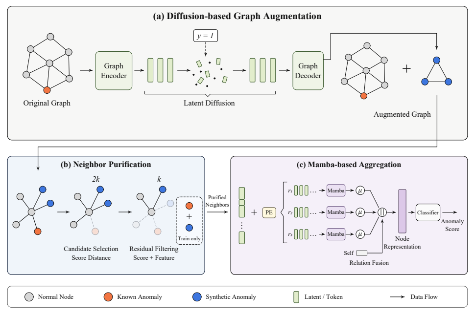

# DASNA

**Diffusion Augmentation with Selective Neighborhood Aggregation for Graph Anomaly Detection**

[中文说明](README.zh-CN.md)

DASNA studies supervised node anomaly detection with imbalanced labels. Its
pipeline fits a latent diffusion generator on the training subgraph, generates
synthetic anomalies offline, filters neighborhood candidates, and aggregates
relation-specific neighbor sequences with Mamba.



[Framework PDF](docs/figures/framework.pdf) · [Author-supplied abstract](docs/abstract.md)

## Repository layout

```text
dasna/
  augmentation/     Graph autoencoder, latent diffusion, training and generation
  detection/        Neighbor selection, Mamba aggregation, classifier and training
  preprocessing.py  Original graph to adjacency-list conversion
configs/             Six dataset configuration templates
environments/        Two Conda bootstraps and stage-specific dependency records
data/                Local datasets and caches, excluded from Git
docs/                Abstract, framework, environment guide and release notes
scripts/             Runtime checks, data inventory and repository checks
LICENSES/            Component-specific license texts and notices
```

## Environments

Run commands from the repository root. Published examples use the environment
names below. Runtime checks were performed in corresponding existing environments;
reuse your own environment names when working in an existing installation.

| Stage | Example environment name | Observed runtime |
| --- | --- | --- |
| Augmentation | `dasna-augmentation` | Python 3.10, PyTorch 2.6.0+cu124, CPU graph partitioning |
| Detection | `dasna-detection` | Python 3.10, PyTorch 2.8.0+cu128, Mamba CUDA forward pass |

The current augmentation environment cannot execute CUDA kernels on the local
RTX 5060 Ti. Use `--device -1` for its CPU path. Installing a matching GPU stack
is a separate environment migration. The local Mamba build is platform-specific;
the environment files do not guarantee an identical fresh Windows installation.
See [environment setup and verified versions](docs/environment.md).

```bash
conda activate dasna-augmentation
python scripts/check_environment.py --stage augmentation --device cpu

conda activate dasna-detection
python scripts/check_environment.py --stage detection --device cuda
```

## Data preparation

Place the six prepared MAT files with fixed train/validation/test masks in
`data/raw/`. Data files already on this machine have been retained locally.
A Git checkout does not include them. File schemas, expected names, counts,
and historical-cache differences are documented in [data/README.md](data/README.md).

```bash
conda activate dasna-detection
python -m dasna.preprocessing --datasets amazon
```

Preprocessing preserves the distinct Amazon/YelpChi relation graphs. The
generated standalone graphs are loaded directly by the detector.

## Training and generation

For example, generate an Amazon training augmentation in a separate directory
so the historical cache stays intact, then train the detector:

```bash
conda activate dasna-augmentation
python -m dasna.augmentation.train --dataset amazon --ratio 10 --device -1 --output-dir data/generated/train-ratio

conda activate dasna-detection
python -m dasna.detection.train --config configs/amazon.yaml --generated-dir data/generated/train-ratio
```

Use `python -m dasna.augmentation.generate --dataset amazon --ratio 10 --device -1
--output-dir data/generated/train-ratio` to generate from new-format checkpoints
without retraining. Each entry point supports `--help`; generated MAT files are
not overwritten unless `--overwrite` is explicitly selected.

The six YAML files are **configuration templates**, not recovered paper
hyperparameters. Review the augmentation toggle, generated-file suffix, CUDA
settings, and feature dimension before starting a run. Checkpoints are written
under `artifacts/` and are excluded from Git.

Generation uses only original training nodes for fitting. New standalone
samples contain only anomalies and only training masks. A generated node can
become a supervised center and a supplementary neighbor of training positives;
evaluation turns off supplementation. The newly defined augmentation ratio is
a percentage of training anomalies. Historical local caches used all anomalies
as the denominator and must be distinguished from newly generated samples.

## Validation and reproducibility

This repository preparation checks source syntax, importable entry points,
data conversion, runtime dependencies, and small model operations. It does
not rerun the manuscript's six-dataset experiments or verify its reported
rankings. Exact paper configurations, five-run logs, baseline artifacts, and
trained checkpoints were not supplied.

The original residual-selection implementation also has scoring behavior
that requires a method review before paper-level reproduction; its scientific
logic is documented, rather than silently changed during file organization.
See [release notes and known limitations](docs/release-notes.md).

Repeatable small-data test commands and the verified scope are recorded in
[the validation record](docs/validation.md).

```bash
python scripts/check_repository.py
```

The GitHub workflow runs the lightweight repository checks. It does not run
GPU training or download datasets.

## Source and licensing

Old upstream project descriptions, badges, package metadata, and publishing
workflows have been replaced with DASNA documentation. Required source and
license notices are retained in [THIRD_PARTY_NOTICES.md](THIRD_PARTY_NOTICES.md)
and [LICENSES/](LICENSES/). See [the component licensing scope](LICENSE.md)
before redistributing the source. This repository does not assign a blanket
open-source license to components without a confirmed redistribution grant.
