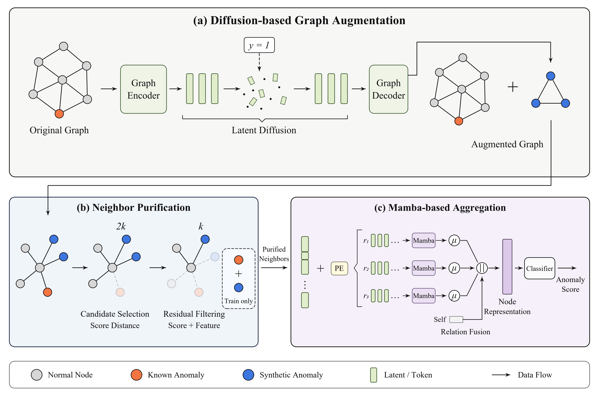

# DASNA

**面向图异常检测的扩散增广与选择性邻域聚合**

[English](README.md)

DASNA 面向标签不平衡的监督式节点异常检测。整体流程分为三个部分：在训练子图上拟合扩散生成器，离线生成异常节点；构造并筛选邻居候选；通过多分支 Mamba 聚合得到节点表示和异常分数。



## 运行环境

```bash
torch-geometric==2.7.0
pygod==1.1.0
tqdm==4.67.3
torch==2.8.0
numpy==2.2.6
scipy==1.15.3
scikit-learn==1.7.2
PyYAML==6.0.3
einops==0.8.2
transformers==4.36.2
mamba ssm==2.2.3 
causal-conv1d==1.4.0
```

## 数据与运行

```bash
python -m dasna.preprocessing --datasets amazon

python -m dasna.augmentation.train --dataset amazon --ratio 10 --device -1 --output-dir data/generated/train-ratio

python -m dasna.detection.train --config configs/amazon.yaml --generated-dir data/generated/train-ratio
```
